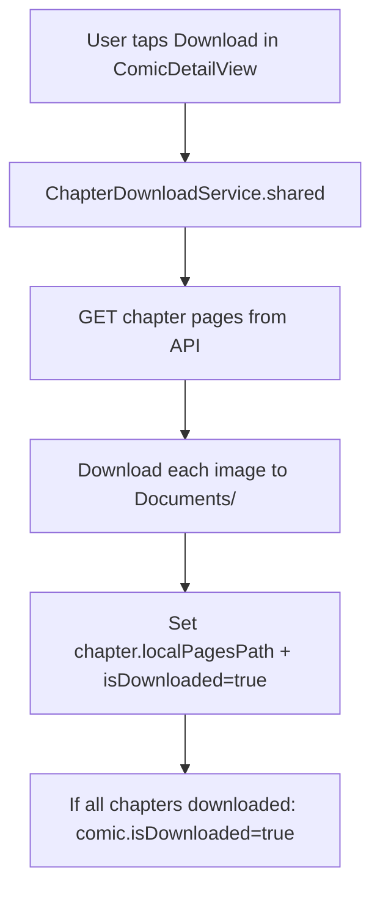
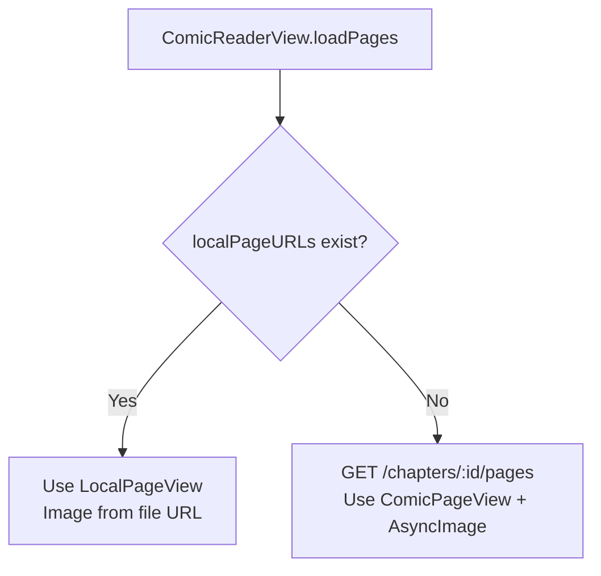

# Offline Mode

> How comics can be downloaded for offline reading.

## Overview

ChapterDownloadService downloads comic page images to the device's Documents directory. When opening a chapter, the reader checks for local files before making an API call.

## Components

| Component | File | Role |
|-----------|------|------|
| ChapterDownloadService | `Packages/ComicFeature/.../Services/ChapterDownloadService.swift` | Downloads images, manages local storage |
| ComicReaderView | `Packages/ComicFeature/.../Reader/ComicReaderView.swift` | Checks local pages before API call |
| LocalComicChapter | `Packages/Core/.../Models/LocalComicChapter.swift` | isDownloaded flag, localPagesPath |
| LocalPageView | `Packages/ComicFeature/.../Reader/ComicReaderView.swift` | Renders from local file URL |

## Download Flow

## Reader Flow (local-first)

In `ComicReaderView.loadPages()`:
1. First checks `ChapterDownloadService.shared.localPageURLs(for: chapter)`
2. If local URLs exist and are non-empty → uses them (no network)
3. Otherwise → API call for PageResponse[] → AsyncImage loads from static server

## Storage

- **Location:** App Documents directory
- **Limits:** `ComicStoragePolicy.limit` bounds the number of comics with saved pages (default 2); `AppConfig.comicDownloadLimitBytes` separately bounds their bytes. Both are adjustable in Settings.
- **Cleanup:** Settings → Manage saved content removes source-backed copies while retaining story metadata, bookmarks and reading position. The story detail menu deletes the whole story.
- **Local-file protection:** Removing saved copies is disabled for `sourceKey == "local"` in both Storage and `LocalStorageService`. Reimporting currently creates new story/chapter identities, so it cannot restore retained bookmarks or reading position to that entry. Export a library backup before deleting a local story to free space. Restoring a backup replaces the complete collection.

## Streamed page cache

Pages read without saving the chapter are kept in `Library/Caches/comicPages` by `ComicPageCache` (Core). It is a purgeable, least-recently-read cache capped at 400 MB, trimmed to 300 MB. It exists so scrolling back up a streamed chapter, or re-opening it, does not download every strip again. MangaDex pages are keyed by their `/data/<hash>/<file>` path because at-home server hosts change between requests.

- It is not offline storage: iOS may clear it, and it does not count toward offline comics or the byte budget.
- Settings → Storage shows its size under "Recently read pages" with a Clear action.
- `ComicPageRatios` remembers measured page width/height (and reads header dimensions of saved and cached files up front), so placeholders keep the right height and long strips don't reflow while loading.
- DEBUG builds read `AstralSlowPages` from user defaults to add 0.9–3.5 s per page download, for reproducing slow-source behaviour.

File references:

- `ios/Astral/Packages/Core/Sources/Core/Services/ComicPageCache.swift`
- `ios/Astral/Packages/ComicFeature/Sources/ComicFeature/Reader/ComicImagePipeline.swift`

## Local comic folders

`LocalFileImportService` accepts a folder containing page images or a folder containing one image subfolder per chapter. Filenames and chapter folders use natural ordering. A mixed layout (for example, root `cover.jpg` plus `Chapter 1/`) is rejected with guidance before any page copying, so a cover cannot silently hide the chapters. Move root images into a chapter folder or choose a folder containing only page images.

Folder validation produces one page/chapter plan. Byte reservations and copying use that same plan; unrelated nested images do not consume reserved space. Symbolic links, invalid page images, cancellation, disk limits and storage limits still fail the import without exposing an incomplete story.

File references:

- `ios/Astral/Packages/Core/Sources/Core/Services/LocalFileImportService.swift`
- `ios/Astral/Packages/Core/Sources/Core/Services/LocalStorageService.swift`
- `ios/Astral/Packages/DesignSystem/Sources/DesignSystem/LibraryStorageView.swift`

## Fanfic Offline

Fanfic chapters store text in `LocalFanficChapter.localTextPath` when downloaded. Similar pattern but for text instead of images.
