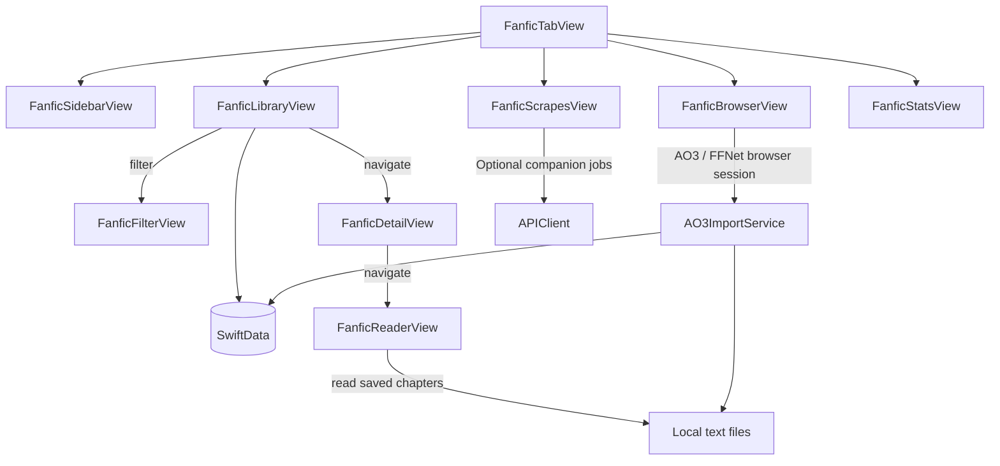

# FanficFeature Package

> All fanfic-related views, view models, and services. Depends on Core, Networking, DesignSystem.

## Entities

### Views

| Name | File | Description |
|------|------|-------------|
| FanficTabView | `FanficTabView.swift` | Root fanfic tab: sidebar drawer + main content area |
| FanficSidebarView | `FanficSidebarView.swift` | Slide-over sidebar: Recent Stories, Library, Search, Downloads, Browse, Scrapes |
| FanficLibraryView | `Library/FanficLibraryView.swift` | Local SwiftData library with search, filters, favourites and reading progress. No automatic backend sync. |
| FanficDetailView | `Library/FanficDetailView.swift` | Fanfic detail: summary, metadata (fandom, rating, word count, characters), chapter list. Navigates to reader. |
| FanficFilterView | `Library/FanficFilterView.swift` | Bottom sheet filter: fandom, rating, completion status, word count range, language |
| FanficReaderView | `Reader/FanficReaderView.swift` | Text reader with chapter picker. Customizable font size, line height, background color. Scroll position tracking for progress. |
| FanficBrowserView | `Browser/FanficBrowserView.swift` | WKWebView with source picker. AO3 and FFNet import directly on device using the browser session. |
| FanficScrapesView | `Scrapes/FanficScrapesView.swift` | Scrape job list for fanfic scrapes. Same pattern as ComicScrapesView. |
| FanficStatsView | `Stats/FanficStatsView.swift` | Fanfic statistics dashboard |

### ViewModels

| Name | File | Description |
|------|------|-------------|
| FanficLibraryViewModel | `ViewModels/FanficLibraryViewModel.swift` | Legacy backend synchronization implementation; no longer invoked by the local library. |

## AO3 Imports Without a Backend

Open **Add**, select AO3, open a work, and tap **Import AO3 work** (the download arrow).
The work appears in Library with all currently posted chapters saved for offline reading.

`Services/AO3ImportService.swift` executes `Resources/AO3Import.js` inside the existing
WKWebView session. It reads the full-work HTML, metadata and chapter bodies directly
from AO3. No cookies or content are sent to the Astral backend. The current reader's
plain-text chapter format is reused; images and rich HTML formatting are not imported.

The importer validates the posted chapter count and rejects missing/empty bodies,
login pages, rate limits and verification pages before changing the saved work. Login
or verification is completed in the visible browser before retrying. It writes a new
set of chapter files before saving SwiftData and removes old files after a successful
save. A failed import leaves the previous copy intact.

Reimporting the same canonical work URL updates the existing entry and preserves
chapter IDs, favourites, bookmarks and reading position. **Update from AO3** in the
detail toolbar opens the work in Browse for an explicit reimport. AO3 reading progress
and permanent deletion stay local. Existing AO3 entries without saved text need a
one-time reimport; there is no backend fallback for missing chapter files.

## FFNet Imports Without a Backend

Select FFNet in **Add**, open a story and tap **Import FFNet story**. The importer
uses normal visible chapter navigation in the phone's WKWebView, supports desktop
and mobile layouts, and saves validated plain-text chapters to the same local
library/reader. No Astral backend is involved. Keep Astral open during acquisition.

Imports check chapter count and ordinal identity, pace acquisition and retain a
short-lived checkpoint for retry. An interrupted acquisition does not create a
partially completed library entry. Verification/login remains in the source browser;
source protection can interrupt an import. Update and restoring removed text use
this same importer. See the [phone sources verification record](../../docs/2026-10-21-phone-sources-and-storage.md)
for the current live acceptance boundary.

## Fanfic reliability follow-up

The [reliability repair record](../../docs/2026-10-21-fanfic-reliability-repairs.md)
covers prepared chapter text and isolated scroll progress, on-device thumbnail
repair (including existing library entries), and FFNet chapter-count/Next-chain
validation. Pull navigation, passage bookmarks, resume and the reading-activity
heat map remain. Runtime acceptance limitations are recorded separately from
fixture/build results.

## Relationships

## Reader Details

FanficReaderView renders chapter text as styled HTML/attributed string. Customization:
- Font size (adjustable)
- Line height (adjustable)
- Background color (dark/sepia/light)

Scroll position tracked for reading progress. Progress written to local SwiftData.

## Filter System

FanficFilterView filters and sorts the local library:
- `fandom` — freeform text (from AO3/FFNet metadata)
- `rating` — dropdown (G, T, M, E for AO3; K, K+, T, M for FFNet)
- `completion_status` — In Progress / Complete
- `sort` — title, word_count, updated_at, etc.
